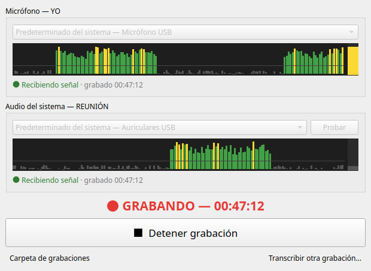
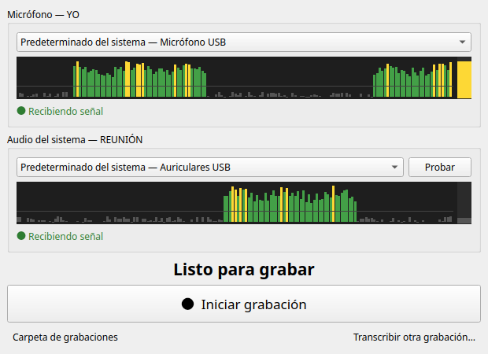
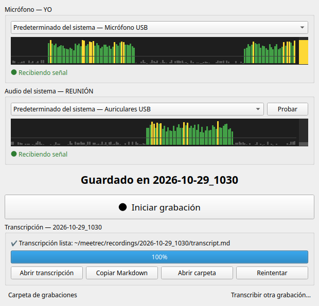

# 🎙️ meetrec — Grabador de Reuniones

**Grabá cualquier reunión (Meet, Zoom, Teams, Discord…) y obtené la transcripción en Markdown, 100 % local.**

Graba tu **micrófono** y el **audio del sistema** en dos pistas separadas y, al detener, genera un
`transcript.md` que distingue quién habló (**YO** / **REUNIÓN**) usando Whisper en tu propia GPU.
Sin bots que se unan a la llamada, sin APIs, sin subir audio a ningún lado.

<p align="center">
  
</p>

## ✨ Características

- **Dos canales independientes**: tu voz y la de los demás quedan en WAV separados, así la transcripción sabe quién dijo qué.
- **Transcripción local** con [faster-whisper](https://github.com/SYSTRAN/faster-whisper) (`large-v3-turbo`), con fallback automático CUDA fp16 → int8 → CPU.
- **No interfiere con nada**: captura desde PipeWire como un consumidor más; no cambia dispositivos, volúmenes ni crea loopbacks.
- **A prueba de cortes**: si la app se cuelga o se corta la luz, la grabación se recupera al reabrir.
- **Reconexión automática** si desenchufás los auriculares o se reinicia PipeWire, manteniendo ambos canales sincronizados.
- **Indicadores de nivel en vivo** para confirmar que los dos canales reciben audio *antes* de empezar.

## 📸 Capturas

| Listo para grabar | Transcripción terminada |
|:---:|:---:|
|  |  |

Resultado (`transcript.md`):

```markdown
# Reunión
Fecha: 2026-10-29
Inicio: 10:30
Duración: 00:47:12
Participantes: YO (quien grabó, micrófono local); REUNIÓN (resto de participantes, audio de la computadora)

## Transcripción

**[00:00:04] REUNIÓN**

Buenas, ¿me escuchan? Bien, arrancamos. La idea hoy es repasar el estado del deploy y cerrar las prioridades del sprint.

**[00:00:15] YO**

Sí, se escucha perfecto. Del lado del backend ya está todo mergeado, falta solamente la migración de la base.
```

## 🚀 Instalación

Requisitos: Linux con **PipeWire** (`pw-record`, `pw-dump`), Python ≥ 3.10. Una GPU NVIDIA es recomendable pero no obligatoria.

```bash
git clone https://github.com/jerem1as/meetrec.git
cd meetrec
./install.sh
```

El instalador crea un entorno virtual, deja el comando `meetrec` en `~/.local/bin` y agrega
**Grabador de Reuniones** al menú de aplicaciones. No usa `sudo`. Para desinstalar: `./uninstall.sh`
(no borra las grabaciones).

## 🧑‍💻 Uso

1. Abrí **Grabador de Reuniones** desde el menú, o ejecutá `meetrec`.
2. Verificá que se muevan los dos indicadores (hablá / tocá **Probar**).
3. **Iniciar grabación** → **Detener grabación** → se transcribe sola.
4. **Abrir transcripción** o **Copiar Markdown** y pegalo donde quieras (por ejemplo, en un LLM para resumir la reunión).

Cada grabación queda en su propia carpeta:

```
recordings/2026-10-29_1030/
  mic.wav          # YO
  meeting.wav      # REUNIÓN
  transcript.md    # producto final
  transcript.json  # fragmentos con tiempos (para reprocesar)
  session.json     # metadatos: dispositivos, huecos de audio, modelo usado
```

### Línea de comandos

```
meetrec                      # abre la app
meetrec transcribe <carpeta> # (re)transcribe; --device cpu|cuda, --model, --language auto
meetrec repair <carpeta>     # repara WAV de una grabación cortada
meetrec devices              # lista entradas/salidas de PipeWire
```

## 🔧 Cómo funciona

Cada canal es un `pw-record` que crea un stream de captura **adicional**:

- **Micrófono** → se conecta a la fuente del mic como una app más. PipeWire reparte la señal a
  todos los consumidores, así que Meet/Zoom siguen recibiendo exactamente lo mismo.
- **Sistema** → se conecta a los puertos `monitor_*` de la salida (una copia pasiva de lo que suena).

Los nodos `meetrec.mic` / `meetrec.system` (visibles en qpwgraph) desaparecen solos cuando termina
el proceso, incluso si la app se cuelga.

### Robustez

- WAV a prueba de cortes: cabecera actualizada cada 2 s y `fsync` cada 10 s.
- Si un canal se corta, se reconecta y rellena con silencio para mantener la sincronía; el hueco queda anotado en el Markdown.
- "Predeterminado del sistema" sigue al dispositivo por defecto (p. ej. al conectar auriculares), o podés fijar uno concreto.
- Avisos visibles: canal sin datos, canal en silencio por más de 3 min, disco con menos de 1 GB libre.
- La transcripción corre en un proceso aparte: si falla, los audios quedan intactos y podés reintentar.

## ⚙️ Configuración

`~/.config/meetrec/config.json` (se crea al elegir un dispositivo):

| Campo | Default | Descripción |
|---|---|---|
| `recordings_dir` | `./recordings` | Dónde se guardan las grabaciones |
| `sample_rate` | `16000` | Frecuencia de muestreo |
| `model` | `large-v3-turbo` | Modelo de Whisper (`large-v3` es algo más preciso y más lento) |
| `language` | `es` | Idioma; `null` = autodetectar |
| `device` | `auto` | `auto`, `cuda` o `cpu` |
| `initial_prompt` | — | Nombres propios / jerga para orientar a Whisper |
| `label_mic` / `label_system` | `YO` / `REUNIÓN` | Etiquetas de cada canal en el Markdown |

Log: `~/.local/state/meetrec/meetrec.log`.

## ⚠️ Limitaciones conocidas

- Con parlantes en vez de auriculares, el micrófono también capta la reunión y esas frases pueden aparecer duplicadas como YO.
- El canal "sistema" incluye cualquier sonido de la PC (notificaciones, música).
- Solo Linux con PipeWire.
